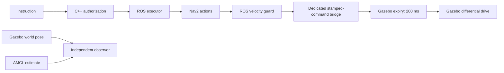

# Phase 3.2 reproduction

This study is simulation only. The unchanged C++ validator authorizes missions;
Nav2 chooses velocities; a ROS guard checks health; a separate Gazebo system
expires stamped commands downstream of the ROS bridge. Neither action cancellation
nor a zero command proves actual stopping. The independent pose observer measures
sampled motion from Gazebo, not from AMCL or Nav2 feedback.

## Installation

Use the existing Phase 3.1 Windows Python environment and Ubuntu 24.04 WSL2
ROS Jazzy / Gazebo Harmonic / Nav2 installation. A VS Code WSL connection is
optional: every WSL command can be issued from a normal Windows terminal.
Install the research extra (`python -m pip install -e ".[dev,research]"`).
No model download is needed for these deterministic navigation experiments.
Previously installed Qwen weights remain local and are not used by this study.

In Ubuntu, from `/mnt/d/Projects/OakGPT`:

```bash
source /opt/ros/jazzy/setup.bash
cmake -S robotics/command_expiry -B ~/projects/oak-expiry-build \
  -DCMAKE_BUILD_TYPE=RelWithDebInfo -DOAK_BUILD_GAZEBO_PLUGIN=ON
cmake --build ~/projects/oak-expiry-build --parallel 2
ctest --test-dir ~/projects/oak-expiry-build --output-on-failure
colcon build --base-paths robotics/ros2_ws/src \
  --build-base ~/projects/oak-ros-phase32-v5-build \
  --install-base ~/projects/oak-ros-phase32-v5
```

Set `OAK_EXPIRY_PLUGIN_DIR` to the built plugin directory for manual launches.
The owned session runner sets it explicitly. `OAK_FASTDDS_PROFILE` selects
`configs/robotics/phase32_fastdds_services.xml`: service-response reader discovery
can wait up to one second; this does not increase the 30-second mission deadline.
The ABI-specific QoS diagnostic test checks the actual installed FastDDS field.

## Command path and clocks



`oak/nav_cmd_vel` is never connected directly to the drive. The bridge carries
`oak/leased_cmd_vel` to Gazebo `/oak/leased_cmd_vel`; the native plugin alone
publishes `/oak/actuator_cmd`. The session audits ROS publisher identities.
Headers carry a producer epoch, monotonically increasing sequence and original
receipt time. Repeated forwarding does not renew that receipt time. Bounds,
malformed stamps, replay and producer changes reject. Once armed, expiration or
a physics-update gap latches zero until a new simulator session. Startup-only
expired neutral messages are discarded, never forwarded or used to renew a lease.

Linux `CLOCK_BOOTTIME` includes suspend time; simulation pause cannot extend a
lease. The plugin runs in the physics process: while that process is stopped it
cannot run code, and simulated physics also stops. SIGSTOP/resume is a proxy,
not an executed Windows sleep, WSL VM suspension or physical actuator test.
Local ROS/Gazebo publishers are trusted; epoch/sequence checks are not transport
authentication and do not defend against a malicious authorized publisher.

## Repeating studies without overwriting evidence

Always use **new output directories**. Keep existing results, including failed
preconditions, startup errors and earlier cleanup defects. Large bags stay under
the Ubuntu `~/projects/oak-bags/` directory. Run only one world at a time, with
unique Gazebo partitions. Avoid builds or other heavy work during measurements.
The supervisor kills only descendants whose PID and process-start identity match
its ownership record and records remaining processes in `STOPPED.json`.

The protocol is `configs/robotics/phase32_protocol.json`. Use development seeds
210–212 for tuning; historical Phase 3.1 worlds are diagnosis only. Freeze the
configuration, runtime binaries and measurement sources **before** creating
fresh held-out seeds:

```powershell
python scripts/freeze_phase32.py --output runs/phase32/my-freeze.json
python scripts/prepare_navigation_worlds.py --split held_out `
  --freeze runs/phase32/my-freeze.json --output runs/phase32/my-held-out-worlds
python scripts/paired_navigation_study.py --freeze runs/phase32/my-freeze.json `
  --worlds runs/phase32/my-held-out-worlds --output runs/phase32/my-paired-study
```

`--resume` checks persisted schedule, asset hashes and runtime hashes. It skips
completed trials (including failures); incomplete trial directories require
inspection and are never silently replaced. Failed missions abort subsequent
dispatch: unattempted requests remain in the planned denominator. Variants use
the same authorization, expiry and middleware, randomized world order and a
balanced variant-first schedule. No held-out tuning or deadline increases.

For actual-motion faults, supply `--launch expiry.launch.py`, the frozen install,
`--overlay configs/robotics/phase32_corrected.json`, middleware profile and freeze
to `scripts/motion_faults.py`. Its seven cases cover guard SIGKILL/SIGSTOP,
watchdog/bridge SIGKILL, stale/replayed payloads and simulator SIGSTOP/resume.
Eligibility is checked again at injection using fresh ground truth and applied
nonzero commands. The unchanged target is settling onset within 0.5 simulation
seconds, sustained for 0.3 seconds, with translation below 0.01 m/s and rotation
below 0.03 rad/s. Missing or ineligible measurements are not passes.

## Analysis and verification

`analyze_phase32.py` recomputes metrics from raw traces, preserves all planned
denominators, and produces a paired seed-cluster bootstrap. Four start seeds
shared across three layout families give very limited uncertainty estimates;
sampled points are not independent experimental replications. Travel comparisons
condition on common completion. Circle/box clearance is a geometric proxy, not
a Gazebo contact sensor or physical collision rate.

Run Python pytest, Ruff lint/format, mypy and wheel/sdist builds. Run
`bash scripts/verify_robotics_phase32.sh NEW_OUTPUT_DIRECTORY` in Ubuntu for
independent release/sanitizer builds, the unchanged 60-case C++ oracle, native
expiry tests and ROS package/node tests. Sanitizers exercise native test
executables; they do not establish sanitized whole-simulator execution.
`archive_phase32.py` compresses exact evidence bytes; its member hashes are
checked by `verify_phase32_archive.py`. No historical archive is regenerated.

## Published freezes and offline analysis

The actual held-out study uses `phase32_freeze.json` (v1, implementation commit
`d38267a`). After all frozen studies finished, three measurement scripts gained
bounded trace-read recovery and prepared active-payload capture. Their v2 hashes
are in `phase32_freeze_v2.json`; installed control artifacts, ROS source and
selected Nav2 parameters are identical. Earlier failures are not replaced.
The v2 payload runner supports `--active-capture`. It warms transport/types before
dispatch, then captures a real nonzero lease and verifies motion before injection.

Freeze checking intentionally rejects changed historical sources. For a byte-exact
v1 source inspection use an isolated worktree at `d38267a`, and retrieve its freeze
and evidence from the published archive. Rebuilt binaries on another machine may
have different hashes: record a **new** runtime/source freeze for a replication,
retain the same protocol/parameters, and use fresh output directories. AMCL and
controller internal randomness is not fully pinned; trajectories are not promised
to be bit-identical.

To recompute the published statistics without running ROS, first verify the archives,
then extract into a new directory. From the repository root in PowerShell:

```powershell
python scripts/verify_phase32_archive.py
$phase32Evidence = Join-Path $PWD 'tmp/phase32-evidence-new'
if (Test-Path -LiteralPath $phase32Evidence) { throw 'Choose a new extraction directory' }
New-Item -ItemType Directory -Path $phase32Evidence
Get-ChildItem reports/phase32/raw/*.tar.gz | ForEach-Object {
    tar -xzf $_.FullName -C $phase32Evidence
}
python scripts/analyze_phase32.py --source $phase32Evidence --output tmp/recomputed-analysis.json
python scripts/plot_phase32.py --source $phase32Evidence `
    --summary tmp/recomputed-analysis.json --output tmp/recomputed-figures
python scripts/build_phase32_report.py --output tmp/rebuilt-report.pdf `
    --markdown-output tmp/rebuilt-report.md
```

The report builder uses the published `analysis-final.json`, verification receipt
and figures. The initial `analysis.json` is retained as an earlier derived summary;
`analysis-final.json` adds descriptive timing/failure details without modifying raw
measurements. Compressed evidence is distributed through Git separately from the
source package. Bags remain local, with byte/hash inventory in the raw archive.
