# Phase 3.3: timing attribution and reliability gate

This work starts from integrated main `e806d56380e812848f1b7a4aadabcacee0d6457d`.
PRs #4 and #5 were merged once; their ancestry, branches and all earlier evidence remain.
PR #6 contains the Phase 3.3 work. No LoRA or physical robot deployment is included.

## Current status (2026-11-04)

The completed quiet-host comparison is archived: 36/36 missions, 12/12 qualified
sessions across three backends and logging on/off. Cyclone is the development-selected
candidate, not a demonstrated navigation improvement. Source checkpoint `57c2b60`
and installed artifacts were frozen in `configs/robotics/phase33_freeze_v1.json`.
Freeze checkpoint `b7e67ac` is pushed. The new 24 worlds and balanced paired schedule
exist, but no held-out mission was dispatched: the actual runner's CPU samples were
21.7-29.5%, above the unchanged 20% ceiling. Its failed preflight is preserved.
Final motion-fault tests are pending; software tests cannot substitute for them.
The final post-QA host sample v15 also failed (34.1-36.5% CPU); it is archived separately.

The current report is [the quiet-host follow-up](../reports/phase33/quiet-followup-report-v2/report.md)
([PDF](../reports/phase33/quiet-followup-report-v2/report.pdf)). Its three pages were
rendered and visually inspected. Earlier reports and all failed trials remain unchanged.
The earlier checkpoint descriptions below are historical, not the current status.
Saved resource observations are summarized separately in
`reports/phase33/quiet-resource-observations-v1.json`: maximum nominal-100-ms
sampling gaps reached 0.958-2.264 s. Main-thread sampling does not cover every
middleware worker or establish the cause of a delay.

Resume only after measuring low host load, with the existing worlds/schedule:

```powershell
.venv-phase31-verify/Scripts/python.exe scripts/phase33_paired.py `
  --worlds runs/phase33/held-out-worlds-v1 `
  --freeze configs/robotics/phase33_freeze_v1.json `
  --output runs/phase33/held-out-replication-v1 --resume
```

Every remaining session performs a new host gate and clock/ROS/TF qualification.
Completed failures and unavailable trials are never retried; incomplete directories
require inspection. Do not regenerate worlds or edit frozen source/configuration.
After replication, run the ten preregistered faults on the frozen Cyclone runtime
using `motion_faults.py --clock-mailbox --rmw rmw_cyclonedds_cpp
--cyclone-config configs/robotics/phase33_cyclonedds.xml --timing --active-capture`,
with the matching freeze/install/expiry/overlay paths and new output directories.
Independently verify fresh nonzero motion and native stale/replay delivery. Preserve
missing preconditions and failures; do not score action cancellation as motion stopping.

**Phase 4: NO-GO on current evidence.** The 200 ms lease, 30 s navigation deadline,
C++ authorization and preregistered acceptance criteria remain unchanged. No LoRA work
or additional robotics scope is authorized by a candidate selection alone.

## Measurement boundaries

```mermaid
flowchart LR
  I[Untrusted structured plan] --> V[Independent C++ authorization]
  V --> E[Mission executor]
  E --> N[Nav2 controller]
  N --> G[ROS velocity guard]
  G --> D[Stamped DDS command]
  D --> B[C++ ROS/Gazebo bridge]
  B --> T[Gazebo transport]
  T --> X[Native 200 ms lease and expiry latch]
  X --> A[Simulated actuator]
  A --> P[Independent Gazebo pose and contact observations]
  G -. sequence identity .-> R[Same-kernel BOOTTIME trace analysis]
  B -. publication and take events .-> R
  X -. ingress and PreUpdate events .-> R
  P -. simulation ground truth .-> H[Motion and contact analysis]
```



The two analysis clock domains remain separate. The diagram describes implemented
data flow, not a certified stopping system. Native expiry shares the simulator process.

Computed cross-process intervals use Linux CLOCK_BOOTTIME within one WSL kernel.
CLOCK_MONOTONIC and thread CPU time are separate fields. DDS source/receive stamps
are realtime; controller and physics stamps are simulation time. Neither is
subtracted from BOOTTIME. Windows clocks measure only local handshake round trips.
The guard sequence and leased frame identifier join guard publication, actual C++
bridge DDS take, Gazebo publication and native decoding. Controller creation and
unstamped ROS input are observed but cannot be assigned a unique command identity
through the entire chain. Publication entry/exit is an API duration, not a wire stamp.
Native ingress-to-PreUpdate includes simulation scheduling and lock contention.
Thread CPU subtraction cannot distinguish sleeping, middleware blocking and CPU starvation.
Timing percentiles use the existing empirical order statistic at zero-based index
`min(n - 1, int(n * q))`; per-session samples are never independent world trials.

The optional preload wraps actual rcl publish/take and installed Gazebo v13 publish
calls. Nav2's RPP wrapper delegates its computation unchanged. Independent native
PostUpdate poses supplement the existing Gazebo pose observer. Actual physics ECM
ContactSensorData provides collision pairs; floor and robot self-contact are excluded
from robot/environment counts. Circle clearance is supplementary, not contact evidence.
An unavailable contact trace is never scored as zero collisions.

Records append to private native tmpfs files and are copied only after owned processes
stop, with byte hashes checked before releasing that owned temporary directory.
CPU pressure/load and owned-process main-thread scheduler statistics are sampled at
10 Hz. Worker-thread scheduling is not exhaustively observed. Native dropped writes
and Python trace errors are reported where subsequent records exist; a terminal lost
record or failed open cannot be ruled out solely from a zero error counter.

## Concrete mutex evidence

`stack-probes-v1/probe-3` captured a **332.892270 ms pthread_mutex_lock wait** inside
Fast DDS RTPSWriter::send_nts, reached by synchronous DataWriter publication. The
full guard publication call was **350.829900 ms**. Installed-library disassembly
and version 2.14.6 source identify the participant's `m_send_resources_mutex_`.
The actual ordinary mutex-lock path is not bounded by the writer's observed 100 ms
reliability max_blocking_time. The owner of this particular 332.9 ms wait was **not
recorded**. This does not establish the cause of Phase 3.2's historical 337 ms event.

Later v10 ownership traces in a different UDP development session record a DDS
flow-controller network-delivery thread holding the watched mutex for **63.165420 ms**.
That is an observed contender, not retrospective ownership evidence for probe-3.
Source inspection also identifies transport-resource creation and cleanup as possible
contenders; their involvement in probe-3 has not been demonstrated. Full stacks,
library hashes, versions, disassembly and the adjacent timeline are archived under
`reports/phase33/attribution-v1/raw` with member hashes.

Deep stack capture is diagnostic and intrusive: it can extend the critical section
and the enclosing publication call. The measured mutex wait precedes stack unwinding,
but the full API duration includes it. Deep stacks are disabled in passive middleware
comparisons. The on/off comparison toggles record output with the same compiled
wrappers/contact configuration; it does not remove all instrumentation code.

## Negative development findings

Four matched development worlds completed 12/12 missions in each SYNC/ASYNC arm.
ASYNC reduced the largest observed publication API call (321.779340 to 109.085850 ms),
but did not improve the largest measured guard-begin to native-decoding delay
(322.156710 versus 329.688360 ms). ASYNC is not selected as a reliability correction.
These are maxima from a small development sample, not population bounds.

A no-motor stopped-reader test published 300 zero commands while its known reader was
SIGSTOP'ed for two seconds. Maximum publication time was 4.334760 ms. This single
condition did not reproduce the 332.9 ms wait; it neither excludes backpressure in
other graphs nor measures robot stopping. Its initial graph-discovery failure is retained.

The first instrumentation builds contained stale objects despite source changes on
DrvFS. Those runs are retained and their absent contact observation is not repaired
retroactively. Builds v7 onward use fresh native source snapshots, separate build/install
directories and source/binary hashes. Completed prefixes are not reused.

## Clock mailbox and experiment availability

The experiment-only mailbox invokes the same independent C++ `--clock` command on
WSL. Each immutable request has a fresh nonce; replies are nonce-bound, schema-checked,
size-bounded and accepted only within the original **one-second host-monotonic round
trip**. A pre-existing request or reply is rejected. Duplicate keys, nonfinite values,
bools, invalid ranges, malformed timing fields and malformed replies fail closed.
No Windows/WSL monotonic comparison is made. The shared local directory and server are
trusted; the nonce is replay protection, not authentication against a malicious local
writer. Independent C++ authorization still reads its own current clock for every mission.

The actual C++ integration accepted a fresh mission and rejected expired and future
missions. A Windows rename conflict on the original shared request slot was corrected
using unique per-challenge files. The first mailbox parser expected plain text although
C++ emits JSON; that defect, and a later ROS-only import failure, produced unavailable
trials. Those outcomes remain in their original cohorts. Corrected runs use a standalone
standard-library JSON parser. Three bounded preparation attempts do not relax the
one-second acceptance requirement for any individual attempt.

## Reproduction and gates

```powershell
wsl -d Ubuntu-24.04 -- bash /mnt/d/Projects/OakGPT/scripts/build_phase33.sh /home/eekeen/projects/oak-phase33-NEW
.venv-phase31-verify/Scripts/python scripts/phase33_backend_development.py --output runs/phase33/NEW --install /home/eekeen/projects/oak-phase33-NEW
.venv-phase31-verify/Scripts/python scripts/summarize_phase33_development.py --source runs/phase33/NEW --output reports/phase33/NEW-summary.json
.venv-phase31-verify/Scripts/python scripts/verify_phase33_archive.py
```

The controlled backend matrix compares current Fast DDS, explicit loopback UDP Fast
DDS, and installed Cyclone DDS with unchanged Nav2 configuration, instructions,
30-second deadline, authorization and 200 ms native lease. Order is seeded and
reversed for the second development world. Sessions are fresh; faulted sessions do
not automatically resume. Startup failures, dispatched failures and unattempted
requests are separate categories. Session tails are reported separately and commands
are not treated as independent evaluation examples.

`configs/robotics/phase33_protocol.json` contains draft held-out acceptance criteria.
No candidate may be frozen until supported by development results. No held-out worlds
have been generated yet. A held-out efficacy claim and final actual-motion fault
verification remain unavailable until that gate is met. The lease and fail-closed
behavior are preserved; ROS cancellation is not proof of simulated or physical stopping.

## Primary references

- Fast DDS 2.14.6 participant sendSync and mutex: https://github.com/eProsima/Fast-DDS/blob/v2.14.6/src/cpp/rtps/participant/RTPSParticipantImpl.h
- Transport-resource contenders: https://github.com/eProsima/Fast-DDS/blob/v2.14.6/src/cpp/rtps/participant/RTPSParticipantImpl.cpp
- Writer send call: https://github.com/eProsima/Fast-DDS/blob/v2.14.6/src/cpp/rtps/writer/RTPSWriter.cpp
- ROS middleware publication: https://github.com/ros2/rmw_fastrtps/blob/jazzy/rmw_fastrtps_shared_cpp/src/rmw_publish.cpp
- Actual contact component semantics: https://github.com/gazebosim/gz-sim/blob/gz-sim8/src/systems/contact/Contact.cc

## Historical quiet-window follow-up (checkpoint 3489b30 and earlier)

Checkpoint `09ea6c9` is pushed to PR #6; all six hosted CI jobs passed (run
41152166372). Local verification is described in `reports/phase33/verification-summary.json`.
The IEEE-style PDF is generated by `scripts/build_phase33_report.py`; all pages were
rendered and visually inspected. The report records NO-GO for Phase 4 on current evidence.

Three measured host baselines failed the declared quiet check (three five-second
samples below 20% total CPU and below 0.5 selected external CPU-core equivalents).
The latest baseline measured 62.9-65.9% total CPU and 5.1-5.6 selected external cores.
No controlled smoke comparison was launched under these conditions. Approval to use
a quiet window is not evidence that the workload actually stopped.

A separate preparation-only diagnostic accepted 10/10 Windows-to-WSL clock mailbox
handshakes, 125-688 ms round trips, with the original one-second limit. It used the
same C++ clock, immutable nonce protocol and 200 ms server polling, without ROS/Gazebo.
This is not a mission result and does not qualify ROS/TF startup under low host load.
Raw requests, replies and host baselines are preserved in the quiet-window follow-up
archive. A further low-load baseline is needed before startup qualification and the
small three-backend smoke. Larger comparisons remain gated on reliable dispatch.

## Completed quiet-host development and candidate selection

The preserved `backend-development-quiet-v1` completed all twelve scheduled sessions
and all 36 requested missions while execution was interrupted. No session was rerun.
Saved preflight baselines and ROS/TF qualification passed in each session; owned-process
cleanup receipts show no remaining processes. Logging-on sessions recorded all required
stages, with no observed expiry latches or >200 ms gaps following nonzero commands.
Logging-off stage latency and contact observations remain unavailable, not zero.

Cyclone is selected for independent replication because its two traced guard-to-native
maxima were 2.369790 and 1.374930 ms. Corresponding Fast DDS maxima were 325.463760
and 318.981420 ms; UDP maxima were 314.946000 and 316.622610 ms. All configurations
completed their missions, so no mission-success advantage is demonstrated. These maxima
include startup neutral commands. In the UDP empty-world worst case, the long interval
was before DDS take despite a fast guard publication return; Fast DDS also retained
long synchronous publication calls. Multiple delay locations must remain distinct.
The historical 337 ms event still lacks causal attribution.

Actual contact samples and floor-pair observations were present in all six traced
sessions; no robot/environment pair was observed in those two development worlds.
This is a small development sample, not a collision-free guarantee. Full raw evidence,
source bytes and negative initial startup-probe attempts are archived separately.
The initial probe used the wrong ROS domain; its failure was instrumentation error,
not evidence of a TF failure. The corrected probe checks two continuous seconds of
scan/TF freshness using the executor's existing [-0.2, 1.0] simulation-second bounds.
It is preparation only and changes neither authorization nor navigation deadlines.

The prior checkpoint report is preserved under `reports/phase33/checkpoints/`.
Candidate source, installed binaries and criteria must be frozen before generating
24 untouched worlds. Until independent held-out and actual-motion fault criteria are
satisfied, the Phase 4 decision remains NO-GO. No LoRA work has begun.
