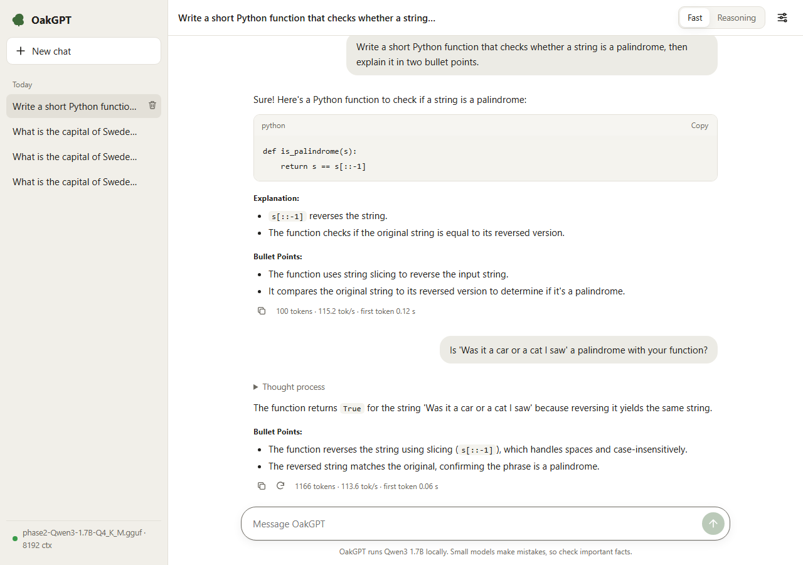

# OakGPT Chat C1: A Local Multi-Turn Assistant on Consumer Hardware

**Design decisions, rationale, sources and measured results**

| | |
| --- | --- |
| Track | Chat, stage C1 (independent of the robotics phase numbering) |
| Branch | `feature/chat-c1-local-web-chat` |
| Implementation commit | `c4a290e` |
| Hardware | NVIDIA GeForce RTX 2060, 6 GB VRAM, driver 560.94, Windows 10 19045 |
| Inference | llama.cpp `b11930-85cc432e2`, Qwen3 1.7B Q4_K_M from Phase 2 |
| Date | 2026-11-22 |

## Abstract

OakGPT C1 adds a ChatGPT-style assistant to the project that runs entirely on one
consumer PC. A browser UI streams replies from Qwen3 1.7B, which is served by a loopback
llama.cpp process. It keeps multi-turn history, supports a selectable reasoning mode and
stores conversations as local files. Nothing is sent to a remote service.

Conversation formatting matches the model's own chat template at the token level. A live
test against the GGUF template and tokenizer confirms this. Message text cannot create
role delimiters. Enabling the llama.cpp prompt cache lowers median time to first token at
the eighth turn from 215 ms to 55 ms in a paired study. The cost is greedy outputs that
differ from uncached evaluation.

This report records each important decision with its alternatives, justification,
evidence and sources. It also records what was not measured. C1 is a product-engineering
stage. It makes no claim about answer quality; no chat quality evaluation was run.

## 1. Goal and scope

The goal is a portfolio-quality "own ChatGPT": a usable, private assistant that shows
end-to-end engineering on limited hardware. C1 covers:

- the chat interaction (multi-turn history, streaming, stop and regenerate, system
  prompt, reasoning mode)
- local persistence
- a browser UI
- security appropriate to a local web service
- reproducible latency and memory measurements

C1 explicitly excludes fine-tuning. That is planned as stage C2, a separately measured
hypothesis (Section 8).

## 2. System overview

```text
Browser (index.html + app.js, same origin only)
   |  fetch + Server-Sent Events, JSON only
   v
oakgpt chat  (Python standard library, 127.0.0.1:8765)
   |-- server.py   Host/Origin/Fetch-Metadata checks, CSP, routing, SSE
   |-- store.py    one JSON file per conversation, atomic replace (runs/chat/)
   |-- engine.py   context planning, sampling presets, stream statistics
   |-- template.py Qwen3 ChatML rendering as (text, control) segments
   `-- reasoning.py incremental <think> / answer separation
   |  native token IDs, loopback HTTP, proxies bypassed
   v
llama-server b11930 (127.0.0.1:18080, --parallel 1, -c 8192, -ngl 99)
   `-- phase2-Qwen3-1.7B-Q4_K_M.gguf on the RTX 2060
```

`oakgpt chat --config configs/chat/qwen3_q4km.json` starts and supervises llama-server.
It verifies that the server loaded the configured model path, then opens the UI.
`oakgpt chat-measure` runs the latency study in Section 5.

## 3. Decision records

Each record states the decision, the alternatives considered, the justification and its
consequences. Bracketed numbers refer to Section 10.

### D1. Build the assistant on a pretrained model, not the scratch Transformer

**Decision.** Serve Qwen3 1.7B, a pretrained instruction-tuned model, as the assistant.
The OakGPT scratch Transformer remains a research artifact.

**Alternatives.** Instruction-tune the scratch model for chat, or offer both.

**Justification.** The best Phase 2 scratch model reaches a test NLL of 2.8459 per byte
token on WikiText [1]. Phase 2 calls this "an early-budget engineering baseline, not a
converged architecture ranking". A model of that size and training budget cannot hold a
useful conversation. Qwen3 1.7B is trained by its authors for both a thinking and a
non-thinking chat mode [2], [3]. It already runs locally at about 87 decoded tokens/s on
this GPU [1]. The portfolio value of C1 lies in the system around the model. Training
remains a separate, honestly evaluated track (C2).

**Consequences.** The UI states that a small local model makes mistakes. Model licensing
follows the upstream Apache 2.0 declaration recorded in the README.

### D2. Separate chat track and branch

**Decision.** Name the work "Chat C1" and branch from the current HEAD of
`remediation/phase33-executor-restart`, not from `main`.

**Justification.** "Phase 4" already means the robotics gate, which the Phase 3.3
evaluation recorded as **NO-GO**. Reusing the label would make that record ambiguous.
Branching from the current HEAD keeps README and roadmap edits free of conflicts with
the 13 unmerged robotics commits. The user chose this. The chat package does not depend
on robotics code.

### D3. Default quantization: Q4_K_M, with Q8_0 as an alternative configuration

**Decision.** `configs/chat/qwen3_q4km.json` is the default.
`configs/chat/qwen3_q8.json` is kept as an alternative.

**Evidence.** The matched Phase 2 study converts both files from the same F16 GGUF,
which came from upstream revision `70d244cc…` [1]. It measured:

| Metric (Phase 2, same hardware) | Q4_K_M | Q8_0 |
| --- | --- | --- |
| Short-task exact accuracy, 48 prompts | 0.271 | 0.271 |
| Paired difference, bootstrap 95% CI | 0.000 [0.000, 0.000] | |
| Median decode rate, short workload | 86.8 tok/s | 64.3 tok/s |
| Median decode rate, long workload | 93.9 tok/s | 66.4 tok/s |
| File size | 1.28 GB | 2.17 GB |

**Justification.** Q4_K_M decodes about 35% faster and leaves more VRAM for the KV cache
(D4). Phase 2 observed no accuracy difference.

**Limitation.** That accuracy comparison uses one narrow, strictly scored task. "No
observed difference" does not establish equivalence for open-ended chat. This is why the
Q8_0 configuration is kept.

**Provenance correction.** The first draft of the configuration copied the model
revision of the official Q8 GGUF repository. The Phase 2 files descend from a different
upstream revision (`70d244cc86ccca08cf5af4e1e306ecf908b1ad5e`). This was caught and
corrected before commit. The configuration now points to
`reports/phase2/quantization_artifacts.json`.

### D4. Context length: 8192 tokens

**Decision.** Start llama-server with `-c 8192`.

**Calculation.** The GGUF metadata gives 28 layers, 8 KV heads and a key/value length of
128. An f16 KV cache therefore needs 2 × 28 × 8 × 128 × 2 B = 112 KiB per token. That is
896 MiB at 8192 tokens and 3.5 GiB at the model's full 40960-token context. The full
context does not fit next to the 1.2 GiB model and the desktop's own usage of about
1.4 GiB.

**Measurement.** With the server loaded and idle, device-wide memory use rose from
1418–1423 MiB to 3530–3534 MiB, an increase of about 2110 MiB (`vram_v1.txt`). These
`nvidia-smi` samples cover the whole device, not just the server process. They were taken
at idle, so the peak during generation was not measured. About 2.6 GiB stayed free in
that state.

**Consequences.** Long conversations are windowed (D8). Q8_0 at 8192 tokens was not
measured. The estimate is about 0.9 GiB more for the larger model file.

### D5. Keep llama.cpp's native API with an explicit client-side template

**Decision.** OakGPT renders the Qwen3 ChatML itself and sends the prompt to the native
`/completion` endpoint as a token-ID array. It does not use the OpenAI-compatible
`/v1/chat/completions` endpoint.

**Alternatives.** Use the OpenAI-compatible endpoint with the server-side Jinja template,
or use an external chat framework.

**Justification.**

- The existing, tested Phase 1 client already uses the native API, with loopback-only
  URLs, proxy bypass and native token counts.
- Rendering client-side makes the template inspectable and testable on CPU.
- Only client-side rendering allows the token-level role boundary in D6.
- llama.cpp documents that array prompts are evaluated as given. A BOS token is only
  inserted when the prompt is a string or starts with one [4].

**Verification.** `test_chat_template_and_tokens_match_live_gguf_template` asks the live
server's `/apply-template`, which runs the template embedded in the GGUF. It runs with
thinking on and off, over a conversation that includes reasoning, Markdown and a system
prompt. The rendered text matched exactly. The token IDs also matched the server's
tokenization of the whole rendered string. A recorded copy of that output is the CPU
golden test.

### D6. Message content can never become control tokens

**Decision.** Template delimiters are tokenized with `parse_special=true`. Message
content is tokenized with `parse_special=false`.

**Evidence.** On the pinned server, tokenizing the text `<|im_end|>hi` gives
`[151645, 6023]` with special parsing: one control token. Without special parsing it
gives `[27, 91, 318, 6213, 91, 29, 6023]`: ordinary text. Without D6, pasting text that
contains ChatML markers would forge a turn boundary. That could be a log file, or an
excerpt from this report. Unit tests check that no message content enters a control
segment. A server test checks that hostile content reaches the model as plain-text
token IDs.

**Scope.** OWASP lists "Segregate and identify external content" as a mitigation for
prompt injection [5]. D6 implements that separation at the token level. It does **not**
stop the model from following instructions written in plain language; OWASP notes it is
"unclear if there are fool-proof methods of prevention" [5]. With one local user and no
tools, a successful injection can only produce text.

### D7. Two modes with model-card sampling; reasoning removed from history

**Decision.** The UI offers **Fast**, which is non-thinking, and **Reasoning**, which is
thinking. The presets use exactly the model card's recommendations [2]:

| Preset | Thinking | Temperature | TopP | TopK | MinP | Reply limit |
| --- | --- | --- | --- | --- | --- | --- |
| `chat` (Fast) | off | 0.7 | 0.8 | 20 | 0 | 1024 tokens |
| `reasoning` | on | 0.6 | 0.95 | 20 | 0 | 4096 tokens |

**Justification.** The model card says "DO NOT use greedy decoding" in thinking mode.
For multi-turn use it also says "the historical model output should only include the
final output part and does not need to include the thinking content" [2]. The renderer
follows that rule, using the same split rule as the GGUF template. The reasoning text is
still stored and shown in a collapsible "Thought process" block. `presence_penalty`
defaults to 0, because the card warns that higher values "may occasionally result in
language mixing" [2]. It can be set per request; the card suggests 1.5 only if endless
repetition occurs.

**Implementation note.** Stream chunks can split `<think>`, `</think>` and the newlines
around them. Tests found two real bugs where a newline leaked into the reasoning text
when a chunk boundary fell next to a tag. Both were fixed. Every chunk size from 1 to
100 characters now yields identical output.

### D8. Context overflow: drop the oldest whole exchanges, visibly

**Decision.** When the prompt plus the reply budget would exceed the context, the engine
leaves out the oldest complete user/assistant exchanges, one at a time. The system prompt
and the newest user message always stay. The UI shows how many exchanges were left out.
If the newest message alone cannot fit, the request is refused, and the user message is
rolled back so the conversation stays valid.

**Alternatives.**

- llama.cpp's context shifting is silent and outside the client's control. The Phase 1
  client explicitly rejects truncation.
- Summarizing old turns adds a model call, latency and a second opportunity for errors.
- Refusing outright forces the user to start over.

**Justification.** Dropping whole exchanges keeps every remaining turn well formed and
the policy is simple to state. The stored conversation is never modified.

### D9. Prompt cache enabled for chat, still disabled for benchmarks

**Decision.** Chat requests send `cache_prompt: true`. The existing benchmark backend is
unchanged and keeps it `false`.

**Evidence.** The paired study is described in Section 5. Without the cache, every turn
re-evaluates the whole history. TTFT grows from 42 ms to 215 ms over eight turns. With
the cache it stays between 37 and 55 ms.

**Trade-off.** llama.cpp documents that with prompt caching the logits "are **not**
guaranteed to be bit-for-bit identical for different batch sizes", which "can cause
nondeterministic results" [4]. This was observed. Greedy replies were identical across
all five repetitions within each condition. They differed between conditions from the
third reply onward, with the wording diverging slightly. For interactive chat with
sampling this does not matter. Measurement code therefore keeps the cache off, and the
existing quantization and benchmark records are untouched.

### D10. Standard-library server, Server-Sent Events and plain JavaScript

**Decision.** The web server is `http.server.ThreadingHTTPServer`. Streaming uses
Server-Sent Events [6]. The UI is about 870 lines of hand-written HTML, CSS and
JavaScript with no build step. It loads no external fonts, libraries or analytics.

**Alternatives.** FastAPI or Flask with a SPA framework, a Gradio UI, or an existing
product such as a third-party chat frontend.

**Justification.**

- `AGENTS.md` asks for small explicit implementations and standard-library
  dependencies.
- An existing chat frontend would hide the engineering that this portfolio stage is
  meant to show.
- SSE fits one-way token streaming. It needs no WebSocket upgrade and works with
  `fetch` plus `AbortController`, so pressing Stop closes the stream.

**Risk accepted.** Python documents that "`http.server` is not recommended for
production. It only implements basic security checks" [7]. The service is therefore
restricted to loopback and one user. The checks it lacks are added explicitly (D11).

### D11. Security model for a localhost web service

**Threat.** Binding to 127.0.0.1 keeps other machines out. It does not stop a malicious
website open in the same browser. Such a site can send requests to localhost, which is
cross-site request forgery. Through DNS rebinding it can also make its own hostname
resolve to 127.0.0.1 and then read responses [8].

**Controls and the source behind each:**

| Control | Defends against | Source |
| --- | --- | --- |
| Bind only to `127.0.0.1`/`::1`; refuse anything else at startup | Network access | — |
| Exact `Host` allowlist (`127.0.0.1:<port>`, `localhost:<port>`), otherwise 421 | DNS rebinding | [8] |
| Reject a present `Origin` that is not our own | CSRF | OWASP, "Using Standard Headers to Verify Origin" [9] |
| Reject state-changing requests with `Sec-Fetch-Site` other than same-origin/none | CSRF | OWASP, "Fetch Metadata headers" [9] |
| State-changing requests must be `application/json`; CORS preflight always refused | CSRF via simple requests | OWASP, "Disallowing simple requests" [9] |
| CSP `default-src 'self'`, `frame-ancestors 'none'`, `nosniff`, `no-referrer` | Script injection, clickjacking | [10] |
| Markdown renderer escapes all text before adding its own tags; links render as text | XSS from model output | [10] |
| Strict 32-hex conversation IDs; static files from an allowlist | Path traversal | — |
| 256 KiB body limit, 32,000-character messages, one generation at a time | Resource exhaustion | — |

OWASP makes a fallback from Fetch Metadata to origin verification mandatory [9]; both are
implemented. Every row except "bind" has a CPU test in `tests/test_chat_server.py`.

**Not covered.** Malware already running as the same user can read the files and the
port. That is outside this threat model.

### D12. Conversation storage: one JSON file per conversation

**Decision.** Each conversation is stored at `runs/chat/conversations/<uuid>.json` with a
format tag (`oakgpt-chat-v1`). Writes go to a temporary file, are flushed and
`fsync`ed, then moved into place with `os.replace`, which is atomic [11].

**Alternatives.** SQLite from the standard library, or one combined file.

**Justification.** Files are human-readable, easy to delete and need no migrations. A
crash cannot corrupt an existing conversation. `runs/` is git-ignored, so private
conversations can never be committed, which follows the rule in `AGENTS.md`.

**Revisit.** Full-text search across many conversations would favour SQLite.

### D13. One generation at a time

**Decision.** llama-server runs with `--parallel 1`. The chat server holds a lock and
answers a second concurrent request with 409.

**Justification.** There is one user and 6 GB of VRAM. llama.cpp splits the context
between parallel slots, so two slots would halve each conversation's context. Queuing
silently behind a hidden request would make the UI appear frozen.

### D14. Stop semantics and partial replies

**Decision.** Pressing Stop aborts the browser `fetch`. The next server write then fails,
which closes the upstream llama.cpp stream and stops decoding. The partial reply is saved
with `"interrupted": true`, so the conversation stays well formed and the next message
works immediately.

**Investigation.** An early end-to-end run suggested the server missed the disconnect. It
turned out the test client never released its socket: `http.client` keeps the socket
open through the response object. Socket probing was added, then removed again, because a
regression test showed disconnects are detected without it. Only code with demonstrated
value was kept.

### D15. Provenance of every reply

**Decision.** Each stored reply records:

- its sampling settings, including the seed actually used (drawn per reply when not
  given)
- prompt token count and dropped exchanges
- server-reported prompt, cache and decode timings, passed through unchanged
- the stop reason (`eos` or `limit`)

The status endpoint reports the model file, its SHA-256 (computed at startup), the server
build and the launch command. Values the server does not report are stored as `null`,
never estimated.

## 4. Verification

| Check | Result |
| --- | --- |
| `pytest` (CPU, no models) | 183 passed, 3 skipped (hardware tests skip without opt-in) |
| `test_chat_template_and_tokens_match_live_gguf_template` (hardware) | passed against llama.cpp b11930 + Q4_K_M |
| `ruff check .`, `ruff format --check .`, `mypy` (strict) | clean |
| Wheel contents | `oakgpt/chat/static/{index.html,app.js,style.css}` included |
| End-to-end, real model | multi-turn replies, reasoning separation, cache reuse, Stop then continue |
| UI, headless Edge | desktop 1280 px and narrow 600 px rendered correctly (figures) |

The narrow layout was checked only down to 600 px. A 420 px capture appeared clipped
at about 500 px, which suggests a minimum window width in headless mode; phone widths
below that are unverified. The UI
JavaScript has no automated browser tests.



## 5. Measured results

### 5.1 Prompt cache study (`cache_study_v1.json`)

**Design.**

- **Script:** an original eight-turn script, `data/eval/chat_cache_script_v1.json`, which
  is for latency measurement only and is never used for training.
- **Decoding:** greedy, non-thinking, at most 96 new tokens per reply, seed 2026.
- **Conditions:** five conversations per condition, in ABBA order on one server process.
- **Cache isolation:** before every conversation the slot cache is overwritten with an
  unrelated flush prompt, so no condition inherits the previous prefix.
- **Recording:** git revision `c4a290e`, with the working tree marked dirty only by
  untracked PDFs that predate this work. The model and binary SHA-256 are in the raw file.

| Turn | Prompt tokens | Cached tokens (on) | Server prompt ms, on / off | Median TTFT ms, on / off | Off ÷ on |
| --- | --- | --- | --- | --- | --- |
| 1 | 75 | 0 | 32.2 / 31.7 | 41 / 42 | 1.03 |
| 2 | 150 | 71 | 31.9 / 51.5 | 37 / 56 | 1.53 |
| 3 | 229 | 146 | 36.1 / 75.2 | 41 / 81 | 2.00 |
| 4 | 293 | 225 | 32.4 / 95.6 | 37 / 100 | 2.73 |
| 5 | 364* | 289 | 32.5 / 112.6 | 37 / 117 | 3.17 |
| 6 | 459* | 353 | 42.6 / 142.5 | 47 / 147 | 3.14 |
| 7 | 554* | 461 | 41.7 / 167.5 | 48 / 172 | 3.57 |
| 8 | 675* | 560 | 49.6 / 209.9 | 55 / 215 | 3.94 |

\* Prompt tokens are those of the cache-off condition. From the third reply onward the
greedy replies differ between conditions (D9), so later prompts differ by up to 10
tokens. At turn 8 the per-conversation TTFT ranged over 53–57 ms with the cache and
209–221 ms without. Decode rate was unaffected: 107–116 tok/s in both conditions.

**Interpretation.** Without the cache, TTFT grows about linearly with history length.
With it, only the new suffix is evaluated. At these lengths the difference is tens to
hundreds of milliseconds. Near the 8192-token limit it would be larger, but that was not
measured.

### 5.2 Memory

The server loaded and idle adds about 2110 MiB, measured device-wide (D4).

### 5.3 Observed behaviour (single samples, not a benchmark)

In the end-to-end smoke test, a follow-up question reused 59 cached tokens and reached
its first token in 32 ms. The first message took 154 ms, with nothing cached.

The demonstration conversation in the figure shows a factual error. Qwen3 1.7B says its
own `s == s[::-1]` function returns `True` for "Was it a car or a cat I saw", which
ignores spaces and capital letters. This is a single observation, kept as an honest
example of the model's limits, not as a measured error rate.

## 6. Limitations and threats to validity

- **Quality.** C1 has no chat-quality evaluation. The one quality number cited (D3) comes
  from a narrow Phase 2 task.
- **Latency.** One host, one script, five conversations per condition and one model
  file. TTFT includes loopback HTTP and Python overhead. Other GPU users (the desktop)
  were not controlled.
- **Memory.** VRAM figures cover the whole device at idle. The peak during generation
  was not measured. Q8_0 was not measured.
- **Browser.** UI behaviour below 600 px and in browsers other than Edge was not tested.
  Accessibility was not audited.
- **Security.** The threat model is a single trusted local user. Prompt injection is
  mitigated only at the token level (D6).

## 7. Development note

While probing the llama.cpp API, an unquoted `*` in a `curl --noproxy *` command was
expanded by the shell into repository filenames. curl then also sent the requests to
hostnames such as `README.md` and `MANIFEST.in`; `.md` and `.in` are real top-level
domains. The payloads were fixed test strings (`<|im_end|>hi`, `S`, `Hi`, `Hello`,
`Again`) and token IDs. No user prompts, datasets or weights were sent. The command was
stopped, the user was informed, and later probes used a Python client that can only
reach 127.0.0.1.

## 8. Next steps

1. **C2, fine-tuning as a measured hypothesis.** Build a frozen chat evaluation set
   first, disjoint from any training data. Then measure LoRA/QLoRA feasibility on 6 GB
   against the unchanged base model, following the existing roadmap rule that a
   fine-tune must not trade safety for a higher score.
2. Conversation search, rename and export, and a SQLite backend if search requires it.
3. Automated browser tests with a headless browser, an accessibility review and a
   narrow-viewport check below 500 px.
4. Measure peak VRAM during generation for Q4_K_M and Q8_0, and TTFT near the context
   limit.

## 9. Reproduction

```powershell
.\.venv\Scripts\python -m pip install -e ".[dev]"
.\.venv\Scripts\oakgpt chat --config configs/chat/qwen3_q4km.json
# Latency study (refuses to overwrite its output):
.\.venv\Scripts\oakgpt chat-measure --config configs/chat/qwen3_q4km.json `
    --script data/eval/chat_cache_script_v1.json --output runs/chat/cache_study.json --repeats 5
# Live template parity test against a running server:
$env:OAKGPT_LLAMA_URL = "http://127.0.0.1:18080"; .\.venv\Scripts\python -m pytest -m hardware -k chat_template
```

These commands need `vendor/llama.cpp/llama-server.exe` and
`models/phase2-Qwen3-1.7B-Q4_K_M.gguf`. Both are produced by the Phase 2 scripts; see
the README.

## 10. References

1. OakGPT Phase 2 research report and quantization records: `reports/phase2/report.md`,
   `reports/phase2/quantization/summary.json`, `reports/phase2/quantization_artifacts.json`.
2. Qwen Team, "Qwen3-1.7B" model card, sections "Switching Between Thinking and
   Non-Thinking Mode" and "Best Practices". https://huggingface.co/Qwen/Qwen3-1.7B
   (accessed 2026-11-22).
3. Qwen Team, "Qwen3 Technical Report," arXiv:2505.09388, 2025.
4. ggml-org, llama.cpp HTTP server README, parameters `prompt` and `cache_prompt`, at
   commit `85cc432e2c8b92925f17dfb8937742541312f1d4`.
   https://github.com/ggml-org/llama.cpp/blob/85cc432e2c8b92925f17dfb8937742541312f1d4/tools/server/README.md
5. OWASP Gen AI Security Project, "LLM01:2025 Prompt Injection," mitigation 6 "Segregate
   and identify external content." https://genai.owasp.org/llmrisk/llm01-prompt-injection/
6. WHATWG, HTML Living Standard, "Server-sent events."
   https://html.spec.whatwg.org/multipage/server-sent-events.html
7. Python Software Foundation, `http.server` documentation, security warning.
   https://docs.python.org/3/library/http.server.html
8. C. Jackson, A. Barth, A. Bortz, W. Shao and D. Boneh, "Protecting Browsers from DNS
   Rebinding Attacks," in *Proc. 14th ACM Conference on Computer and Communications
   Security (CCS)*, 2007.
9. OWASP Cheat Sheet Series, "Cross-Site Request Forgery Prevention Cheat Sheet,"
   sections "Fetch Metadata headers," "Disallowing simple requests" and "Using Standard
   Headers to Verify Origin."
   https://cheatsheetseries.owasp.org/cheatsheets/Cross-Site_Request_Forgery_Prevention_Cheat_Sheet.html
10. MDN Web Docs, "Content-Security-Policy."
    https://developer.mozilla.org/en-US/docs/Web/HTTP/Headers/Content-Security-Policy
11. Python Software Foundation, `os.replace` documentation.
    https://docs.python.org/3/library/os.html#os.replace
